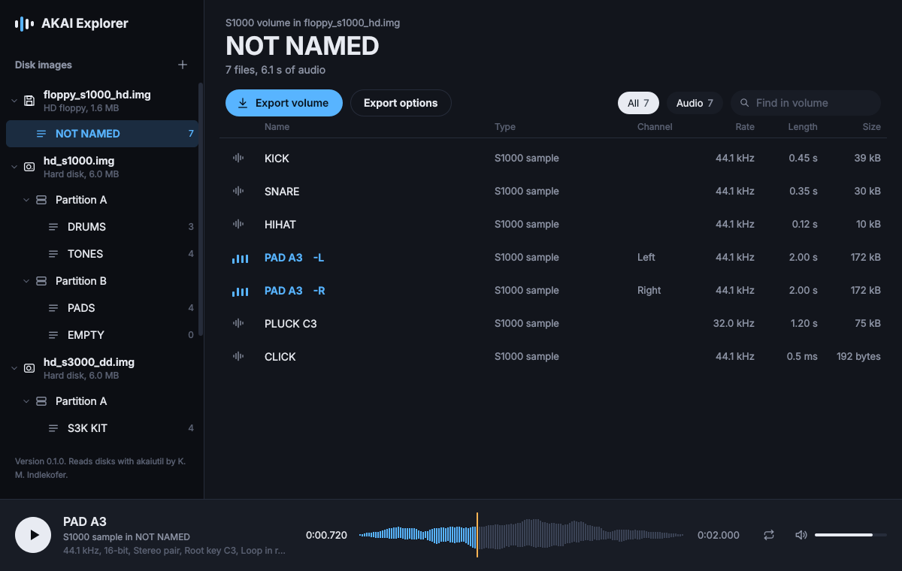

# AKAI Explorer

A file-explorer-like desktop application for disk images of AKAI S900, S950, S1000, S1100
and S3000 series samplers. Open a floppy, hard disk or CD-ROM image, browse its partitions
and volumes, listen to the samples, and export them as WAV files.



AKAI Explorer is a graphical front end for
[akaiutil](https://sourceforge.net/projects/akaiutil/) by Klaus Michael Indlekofer. All
knowledge about the AKAI filesystems and sample formats comes from akaiutil, whose
unmodified C sources are compiled into the application. It was written for the scientific
project "Digital Audio-Converter App" (Prof. Dr. K. M. Indlekofer, Hochschule RheinMain).

## What it does

- Opens one or more disk images at the same time (file dialog, drag and drop, or command
  line). Images are opened read-only and are never modified.
- Shows images, partitions and volumes in a sidebar, and the files of a volume as a list
  with type, sample rate, length and size.
- Previews samples and hard-disk recordings ("DD takes") with a waveform, seeking,
  looping and the loop points stored in the sample header.
- Exports the selected files, a whole volume, or every open image to WAV.
  - A mono sample is written byte for byte as `akaiutil sample2wav` writes it, including
    the chunk with the original AKAI sample header.
  - Samples named `-L` and `-R` can be joined into one stereo WAV (optional, on by default).
  - Programs and other files without audio can be saved unconverted (optional).
- Supports what akaiutil supports: S900/S950 (12-bit, also the compressed sample format),
  S1000/S1100 and S3000 series volumes on floppy, hard disk and CD-ROM images, and DD
  partitions.

Not included in this version: writing to images (importing WAVs, renaming, deleting,
formatting) and editing programs. Use the akaiutil command line for those.

## Build on Linux (tested configuration: Ubuntu 24.04, also under WSL2)

Install the build tools, Qt 6 and the QML modules:

```sh
sudo apt update
sudo apt install build-essential cmake python3 \
    qt6-base-dev qt6-declarative-dev qt6-multimedia-dev \
    qml6-module-qtquick qml6-module-qtquick-controls qml6-module-qtquick-layouts \
    qml6-module-qtquick-templates qml6-module-qtquick-window qml6-module-qtquick-dialogs \
    qml6-module-qtqml-workerscript qml6-module-qtqml-models qml6-module-qtcore \
    qml6-module-qt-labs-folderlistmodel
```

Build, test and run:

```sh
cmake -S . -B build
cmake --build build -j
ctest --test-dir build --output-on-failure
./build/akai-explorer build/testdata/hd_s1000.img
```

Qt 6.4 or newer is required. The build also creates the synthetic test images in
`build/testdata/`, so there is something to open right away.

### Notes for WSL2

- Windows 11 (or Windows 10 with WSLg) shows the window and plays audio without extra
  setup. If no sound device is found, the app says so and everything except listening
  still works.
- If the window does not appear, install `qt6-wayland`, or force X11 with
  `QT_QPA_PLATFORM=xcb ./build/akai-explorer`.
- Building inside the Linux filesystem (for example `~/akai-explorer`) is much faster
  than building under `/mnt/c/...`. A build directory outside the source tree works too:
  `cmake -S /mnt/c/.../akai-explorer -B ~/build-akai`.

### Build options

| Option | Default | Meaning |
| --- | --- | --- |
| `AKX_BUILD_GUI` | `ON` | Build the Qt application. `OFF` builds only the core library and `akx-cli`, without Qt. |
| `AKX_BUILD_TESTS` | `ON` | Build the original akaiutil, generate the test images and register the tests. |

## Using the application

| Action | How |
| --- | --- |
| Open images | "Choose image", the plus button, Ctrl+O, or drop files on the window |
| Listen | Double-click a sample, or select it and press Return. Space plays and pauses. |
| Seek | Click or drag in the waveform. Left and Right arrows when it has keyboard focus. |
| Repeat | Loop button or L. Uses the sample's own loop points when it has any. |
| Next, previous sample | Ctrl+Right, Ctrl+Left |
| Select several files | Ctrl-click, Shift-click, Ctrl+A |
| Export | "Export volume" or "Export selected" (Ctrl+E), then choose a folder |
| Find a file | Ctrl+F |
| Close an image | Hover the image in the sidebar and press the x |

## Command line tool

`akx-cli` uses the same core library without Qt:

```sh
./build/akx-cli list image.img                 # print the directory tree
./build/akx-cli export out/ image.img          # all samples to WAV, stereo pairs joined
./build/akx-cli export --mono --raw out/ image.img
```

## Project layout

```
third_party/akaiutil/   akaiutil 4.6.8, unmodified
src/core/               C++ facade over akaiutil (no Qt): directory tree, decoding, export
src/cli/                akx-cli
src/app/                Qt 6 application: C++ models, audio player, QML interface
tools/                  generators for the synthetic test sounds and disk images
tests/                  automated tests
docs/                   architecture, test report, workflow and prompt log, references
```

More detail: [architecture](docs/ARCHITECTURE.md), [test report](docs/TEST_REPORT.md),
[workflow and prompts](docs/WORKFLOW_AND_PROMPTS.md), [references](docs/REFERENCES.md).

## Licence and credits

AKAI Explorer is free software under the GNU General Public License, version 2 or (at
your option) any later version. See [LICENSE](LICENSE).

It contains akaiutil 4.6.8, Copyright (C) 2008-2025 Klaus Michael Indlekofer, also under
the GPL version 2 or later. The akaiutil distribution adds disclaimers and asks that
projects using it credit the author and mention the use of akaiutil. They are reproduced
in `third_party/akaiutil/README.txt` and apply to that code.

AKAI is a trademark of its owner. This project is not affiliated with or endorsed by
AKAI. The test sounds and test images are synthesized by the scripts in `tools/` and
contain no third-party recordings.
